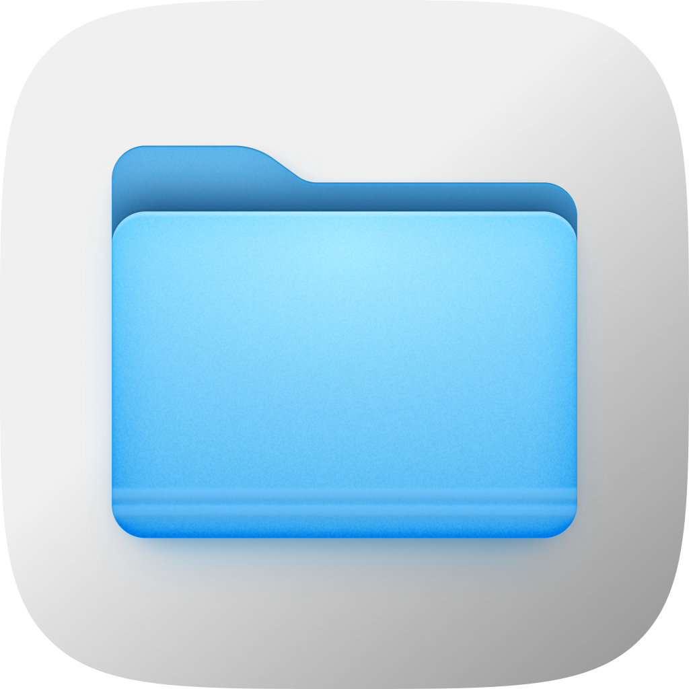

<div align="center">



# Foldr

**A simple Windows tool to change folder icons in a couple of clicks.**

<br>

[](https://ko-fi.com/mindzy)
&nbsp;
[](https://github.com/mindzy007/foldr/issues/new)
&nbsp;
[](https://github.com/mindzy007/foldr/stargazers)

</div>

<br>

## Overview

Drop in your folders, pick an icon, and press **Apply**. Foldr sets the icon without admin rights and refreshes Explorer for you. Changed your mind? **Reset** puts the default icons back.

Foldr is free and open source. If it saves you time, an optional donation on [Ko-fi](https://ko-fi.com/mindzy) is always appreciated.

<br>

## Features

- Drag and drop folders, or use **Add folder**
- Icon library with color palettes, sorting and adjustable icon size
- Optional subfolders and hidden folders
- One-click **Reset** to restore default icons
- Built-in update checker that pulls the latest release from GitHub

<br>

## Requirements

| Requirement | Details |
| --- | --- |
| **OS** | Windows 10 or 11 (64-bit) |
| **Permissions** | No admin rights needed for normal folders |

<br>

## Installation

### Installer (recommended)
1. Download `Foldr-Setup-<version>.exe` from the [latest release](https://github.com/mindzy007/foldr/releases/latest).
2. Run it and follow the prompts.

### Run from source
```bat
git clone https://github.com/mindzy007/foldr.git
cd foldr
run.bat
```
`run.bat` installs the required Python packages and starts the app.

### Build it yourself
Requires Python 3.

```bat
build.bat
```
This creates `dist\Foldr-Setup-<version>.exe`. The version comes from `version.py`.

<br>

## Reporting bugs

Open an [issue](https://github.com/mindzy007/foldr/issues/new) and include your Windows version and Foldr version.
